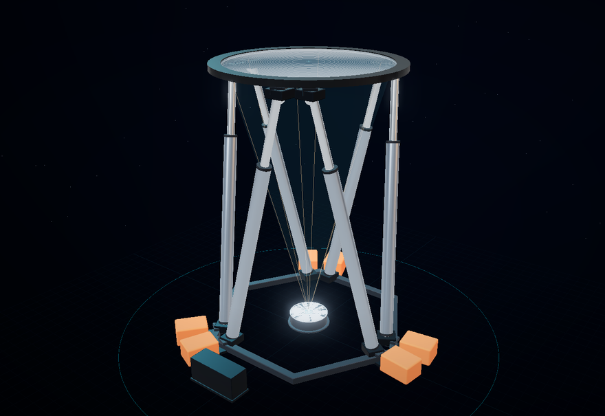

# 户外菲涅尔聚光平台 · 六自由度 Stewart 平台交互拆解演示

在线演示：**https://internalnight.github.io/teardown-dof6/**



一个纯静态的 Three.js（r169，本地内置，无 CDN）交互页面：把一台真实用于"户外菲涅尔透镜聚光成型实验"的
六自由度 Stewart 平台做成可拆解、可六轴调姿的数字样机。

## 内容

- **构件拆解**：基座管框 / 橙色配重 / 上下铰链 / 6 根电动缸 / 上平台（黑色圆环框，菲涅尔透镜嵌在环内与环共面）/ 地面料床，
  沿 Y 轴分层爆炸，带虚线引导线；拆解进度 0–100%。
- **六轴运动**：X / Y / Z / Roll / Pitch / Yaw 六路滑杆 + 数字输入，**真实逆解**
  （`Q_i = t + R·P_i`、`L_i = |Q_i − B_i|`），每帧重排六根缸的朝向与长度，并实时显示六缸长度与限位状态。
- **光路与焦点**：按 `P_focus = C_lens − 2100·n` 每帧计算焦点，光锥 / 光束随平台位姿变化；
  焦点落在料床目标点时显示"锁定"，否则显示偏差（mm）。
- **预设轨迹**：圆角方形 / 圆形 / 8 字 / 螺旋，可播放、暂停、复位。
- **太阳轨迹（追光）**：输入日期、时间、经纬度，按 NOAA 太阳位置算法解算太阳高度角/方位角，画出当日太阳轨迹；
  六轴按「镜面始终垂直太阳光 + 聚光点固定在料床」反解姿态（`C = P_target + 2100·n`）。
  设备倾角限位 ±35°：超出时停在限位锥上、不再跟随太阳，并按薄透镜离轴成像显示镜面-太阳夹角与光斑偏移。
  太阳可沿轨迹直接拖动，也可播放一天的时间轴；夜间自动归位。

## 实机参数（页面内一致）

| 项目 | 数值 |
|---|---|
| 底座 / 上平台铰点圆半径 | 722.9 / 688.6 mm |
| 铰点连接映射（底座→平台） | `[5,0,1,2,3,4]` |
| 平台高度（中位） | 2200 mm（行程 1700–2700 mm） |
| 推杆长度 | 1703.35 mm（全收）→ 2903.35 mm（行程 1200 mm） |
| 透镜 | PMMA 菲涅尔 Ø1300 × 25 mm，名义焦距 2100 mm，采光面积 1.327 m² |
| 焦点（中位） | 料床面 (0, 0, 100) mm |

## 使用

打开 <https://internalnight.github.io/teardown-dof6/> 即可，电脑 / 手机 / 微信内都能看（需支持 WebGL 的浏览器）。

本地也是纯静态：任意静态服务器即可，例如

```bash
python -m http.server 8787
# 浏览器打开 http://127.0.0.1:8787/
```

> 不要直接双击 index.html：ES module + importmap 需要 http 同源加载。

### URL 参数

| 参数 | 作用 |
|---|---|
| `?t=0~1` | 定格拆解进度 |
| `?mode=motion` | 直接进入六轴运动模式 |
| `?mode=sun` | 直接进入太阳轨迹（追光）模式 |
| `?date=2026-06-21&time=11:30&lat=39.9&lon=116.4` | 太阳模式：日期 / 当地时间 / 纬度 / 经度（时区按经度自动取整） |
| `?path=square\|circle\|eight\|helix` | 预设轨迹 |
| `?play=1` | 进页面即播放轨迹 |
| `?ui=0` | 隐藏全部 HUD（录屏 / 出图用） |
| `?cone=0` / `?cone=full` | 关闭 / 加强汇聚光锥 |
| `?view=hero\|front\|side\|top` | 固定机位 |
| `?cam=x,y,z&look=x,y,z` | 手动机位 |
| `?nofx=1` | 跳过后期泛光（排查过曝） |

## 说明

- 全部几何为程序化生成（无外部模型文件），尺寸依据实机项目文档与现场照片复原，**非官方图纸**。
- 逆解几何精确，但无动力学与碰撞干涉检测；极端姿态下缸体与框架可能擦碰。
- 光路为几何示意，不含光学像差、能量分布或热分析；太阳位置为 NOAA 简化算法（无大气折射修正的跟踪解算），
  光斑偏移按理想薄透镜离轴成像 `f·tanε` 估算。
- 追光模式的倾角限位取实机安全盒 A/B ±35°（不是当前滑杆面板的 ±15° 演示值）。
- 本仓库是从私有开发仓库 `internalNight/teardown-lab` 中抽出的**独立发布版**，
  只包含这一个演示所需的最小文件集（约 1.75 MB）。
